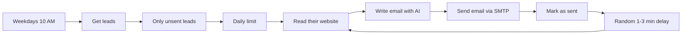

# AI Cold Email Outreach

An **n8n** workflow that writes and sends personalized cold emails. It reads each lead's website, uses AI to write a short email tailored to their business, sends it, and updates the lead's status in Google Sheets.

## Features

- **Lead management in Google Sheets**: only emails leads that haven't been contacted yet
- **Website research**: fetches each lead's website and extracts the text
- **AI-written emails**: generates a unique 60–110 word email with a specific observation about the business and one relevant automation idea (Llama 3.3 70B via the Groq API)
- **Safe sending**: daily limit (10 by default), weekday schedule at 10 AM, and random 1–3 minute delays between emails
- **Status tracking**: marks each lead as `sent` with a timestamp and subject line
- **Easy opt-out**: every email ends with a "reply no" line

## How it works

## Tech stack

n8n · Groq API (Llama 3.3 70B) · Google Sheets · SMTP · JavaScript (Code nodes)

## Setup

1. Create a Google Sheet with a `Leads` tab and these columns:
   `business_name, first_name, email, website, industry, city, status, sent_at, subject`
   Leave `status` empty for leads you want to email.
2. Import `workflows/cold-email-outreach.json` into n8n.
3. Add credentials:
   - **Google Sheets**
   - **Groq**: a Header Auth credential with name `Authorization` and value `Bearer YOUR_GROQ_API_KEY`
   - **SMTP** for sending
4. Set your Google Sheet ID in **Get Leads** and **Mark as Sent**.
5. Fill in the **Settings** node with your name, company, sending email, and service pitch.
6. Test with 2–3 rows containing **your own** email addresses, then activate.

## Responsible use

Send only to businesses where outreach is relevant, use a separate warmed-up sending domain, keep daily volumes low, and honor opt-out replies. Follow the email laws that apply to you and your recipients.
